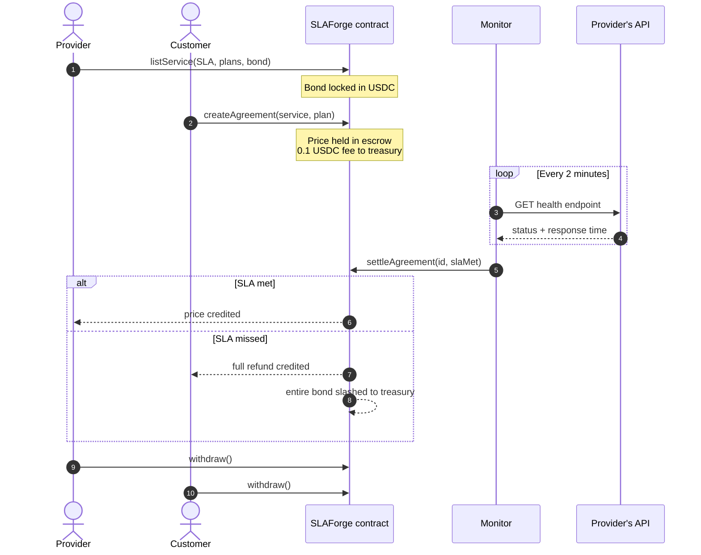
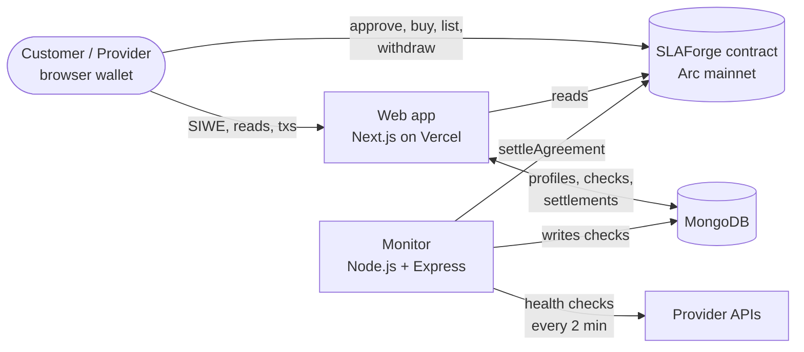

<div align="center">


# SLAForge

**Pay for APIs only when they deliver.**

An API marketplace on Arc where every SLA is backed by a USDC bond and every agreement settles on-chain, based on measured uptime and latency.

[Live app](https://slaforge.streamletedge.com) · [Demo video](https://youtu.be/eEBVDyfeXAg) · [Contract on Arc](https://explorer.arc.io/address/0x24FB87247f850854A1520D4FA13c703FAc68692A)


</div>

---

## Demo

[](https://youtu.be/eEBVDyfeXAg)

Built for the **Arc Microgrants** hackathon by Circle on DoraHacks.

## The problem

Paying for an API today means trusting a promise. Providers advertise 99.9% uptime and fast responses, but when they miss it, customers get an apology or a small service credit, never their money back. The SLA is marketing, not a guarantee.

## The solution

SLAForge puts real money behind every SLA.

- **Providers** list an API with an uptime target (95–100%) and a maximum p95 latency, and lock a **1–100 USDC bond**.
- **Customers** pick a plan and pay in USDC. The payment is held by the smart contract, not the provider.
- **An independent monitor** checks the API's health endpoint **every 2 minutes**.
- **The contract settles automatically:**
  - **SLA met:** the provider is paid.
  - **SLA missed:** the customer gets a **full refund**, the provider's **entire bond is slashed**, and the service is suspended until the provider re-bonds.

Trust stops being a promise and becomes collateral.

## How it works



1. **List.** The provider sets the health endpoint, uptime target, max p95 latency and up to 6 plans (5 minutes to 365 days), and posts a bond.
2. **Buy.** The customer pays the plan price plus a 0.1 USDC platform fee. The price stays in the contract until settlement.
3. **Monitor.** Every 2 minutes the monitor calls the endpoint with a 10 s timeout and records whether it was up and how long it took.
4. **Settle.** When the plan ends, the monitor compares uptime and p95 latency against the SLA and calls `settleAgreement`. If failures go past the downtime the SLA allows, the agreement fails early, so customers don't wait out a broken service.
5. **Withdraw.** Payouts and refunds are credited to a balance and pulled with `withdraw()`, so no address can block settlement.

### Money flow

For a 10 USDC plan with a 50 USDC bond:

| | SLA met | SLA missed |
|---|---|---|
| Customer pays | 10 + 0.1 fee | 10 + 0.1 fee |
| Customer receives | — | **10 (full refund)** |
| Provider receives | **10** | — |
| Provider's bond | stays locked, earning trust | **50 slashed** |
| Treasury | 0.1 fee | 0.1 fee + 50 bond |

## Bond confidence and badges

A bond is a public signal of how much a provider is willing to lose. Every service shows a **confidence score** (0–100, one point per bonded USDC) and a **SLAForge badge**:

| Badge | Bond |
|---|---|
| Bronze | 1+ USDC |
| Silver | 25+ USDC |
| Gold | 50+ USDC |
| Platinum | 100 USDC |

Providers can **top up a live bond at any time** with `increaseBond` to move up a tier, without affecting active customers. After a slash, `rebondService` brings the service back.

## Live on Arc mainnet

| | |
|---|---|
| App | https://slaforge.streamletedge.com |
| Contract | [`0x24FB87247f850854A1520D4FA13c703FAc68692A`](https://explorer.arc.io/address/0x24FB87247f850854A1520D4FA13c703FAc68692A) |
| Network | Arc mainnet (chain ID 5042) |
| USDC | `0x3600000000000000000000000000000000000000` |

**Verified end to end on mainnet with real USDC:** a service was listed with a bond, a customer bought a plan, the monitor checked the endpoint throughout, and the agreement was settled automatically as **Passed**, with the provider's payout credited.

## Architecture



| Part | Folder | Stack | Role |
|---|---|---|---|
| Smart contract | [`protocol/`](protocol) | Solidity 0.8.31, Foundry, OpenZeppelin 5 | Escrow, bonds, settlement, slashing, withdrawals |
| Web app | [`client/`](client) | Next.js 16, React 19, viem, MongoDB | Marketplace, dashboards, agreement pages, payments, profiles |
| Monitor | [`monitor/`](monitor) | Node.js, Express 5, viem, MongoDB | Health checks every 2 minutes and on-chain settlement |

USDC is used for everything: payments, bonds, fees, and gas on Arc.

## Features

- **Marketplace:** search, categories, and sort by confidence, price or uptime.
- **Service pages:** SLA terms, plans, bond, confidence score and badge.
- **Customer dashboard:** active and past agreements, refunds received.
- **Provider dashboard:** listed services, revenue, locked bonds, bond top-up and re-bond.
- **Live agreement pages:** uptime, p95 latency, every health check, countdown and settlement result.
- **Payments:** wallet balance, pending payouts, withdrawable funds and full on-chain transfer history.
- **Wallets:** any EIP-6963 wallet (MetaMask, Rabby, Coinbase Wallet and others), with Sign-In with Ethereum for profiles.

## Smart contract

[`protocol/src/SLAForge.sol`](protocol/src/SLAForge.sol)

| Function | Who | What it does |
|---|---|---|
| `listService` | Provider | Lists an API with its SLA and plans, and locks the bond |
| `increaseBond` | Provider | Adds USDC to a live bond, up to 100 USDC |
| `rebondService` | Provider | Posts a new bond after a slash |
| `delistService` | Provider | Removes a service with no active agreements and returns the bond |
| `createAgreement` | Customer | Buys a plan; price held in escrow, fee to treasury |
| `settleAgreement` | Monitor | Settles as met or missed; slashes the bond on a miss |
| `withdraw` | Anyone | Withdraws credited payouts and refunds |
| `quoteAgreement` | View | Price, fee and total for a plan |
| `setMonitor`, `setTreasury`, `pause`, `unpause` | Owner | Administration |

| Limit | Value |
|---|---|
| Bond | 1–100 USDC |
| Platform fee | 0.1 USDC |
| Plan price | 1 USDC minimum |
| Plans per service | 1–6 |
| Plan duration | 5 minutes to 365 days |
| Uptime target | 95%–100% |
| Max p95 latency | up to 60 s |

### Security

- `Ownable2Step`, `Pausable` and `ReentrancyGuard` from OpenZeppelin 5, with `SafeERC20` for every transfer.
- **Pull payments:** settlement only credits balances, so a reverting or blocked address can't stop it.
- **Separate roles:** owner, monitor and treasury are three different wallets. The monitor can only settle agreements; it can't withdraw or redirect anyone's funds.
- A passing settlement can't happen before the plan ends; a failing one can happen early once the downtime budget is gone.
- Withdrawals keep working while the contract is paused.

### Tests

**105 tests, 100% function and branch coverage.**

- **Unit tests** for every function, revert, boundary and lifecycle path.
- **Fuzz tests** for bond limits, top-ups, early settlement and fund conservation across random prices, durations and bonds.
- **Invariant tests:** a handler runs random sequences of list, buy, settle, withdraw, re-bond, top-up, delist and time jumps. After every step it checks that:
  - the contract always holds enough USDC to cover every bond, escrowed payment and withdrawable balance;
  - the treasury only ever receives fees and slashed bonds;
  - no USDC is created or lost;
  - service and agreement bookkeeping stays consistent.

```bash
cd protocol
forge test
forge coverage
```

## Run it locally

### Prerequisites

- [Foundry](https://book.getfoundry.sh/getting-started/installation)
- Node.js 20.10 or later
- A MongoDB database (MongoDB Atlas free tier works)
- A wallet with USDC on Arc

### 1. Contract

```bash
cd protocol
forge build
forge test
```

To deploy, set these in `protocol/.env`, then run the deploy script with a Foundry keystore account:

```bash
ARC_MAINNET_RPC_URL=https://rpc.mainnet.arc.io
USDC_ADDRESS=0x3600000000000000000000000000000000000000
OWNER_ADDRESS=0x...
MONITOR_ADDRESS=0x...
TREASURY_ADDRESS=0x...
```

```bash
source .env
forge script script/SLAForge.s.sol --rpc-url arc_mainnet --account <keystore-name> --broadcast
```

### 2. Web app

```bash
cd client
npm install
cp .env.example .env.local   # then fill it in
npm run dev                  # http://localhost:3000
```

| Variable | Description |
|---|---|
| `NEXT_PUBLIC_ARC_NETWORK` | `mainnet` or `testnet` |
| `NEXT_PUBLIC_ARC_RPC_URL` | Arc RPC URL |
| `NEXT_PUBLIC_SLAFORGE_ADDRESS` | Deployed contract address |
| `MONGODB_URI`, `MONGODB_DB` | MongoDB connection (server only) |
| `SESSION_SECRET` | Session signing key: `openssl rand -hex 32` (server only) |

### 3. Monitor

```bash
cd monitor
npm install
cp .env.example .env   # then fill it in
npm start              # http://localhost:4000
```

| Variable | Description |
|---|---|
| `ARC_NETWORK`, `ARC_RPC_URL` | Network and RPC |
| `SLAFORGE_ADDRESS` | Deployed contract address |
| `MONGODB_URI`, `MONGODB_DB` | The same database as the web app |
| `MONITOR_PRIVATE_KEY` | Key of the contract's monitor address; keep a little USDC on it for gas |
| `MONITOR_INTERVAL_SECONDS` | Check interval (default `120`) |
| `CRON_SECRET` | Protects `POST /tick` |
| `PORT`, `HOST` | HTTP server (default `4000`, `0.0.0.0`) |

| Endpoint | Description |
|---|---|
| `GET /health` | `200` when the database is reachable and the last run is recent, `503` otherwise |
| `GET /status` | Network, contract, interval and last run |
| `POST /tick` | Runs one check now (`Authorization: Bearer <CRON_SECRET>`) |

See [`monitor/README.md`](monitor/README.md) for deploying it on a VPS.

## Project structure

```
SLAForge/
├── protocol/            Solidity contract (Foundry)
│   ├── src/SLAForge.sol
│   ├── test/            unit, fuzz and invariant tests
│   └── script/          deploy script
├── client/              Next.js web app
│   ├── app/             routes and API routes
│   ├── components/      UI
│   └── lib/             web3, confidence tiers, server code
└── monitor/             Node.js health-check and settlement service
    └── src/
```

## What's next

- Several independent monitors in different regions, settling by quorum
- Partial refunds based on how badly the SLA was missed
- Provider reputation built from settlement history
- An SDK so APIs can check a customer's active agreement before serving a request

## License

[MIT](LICENSE) © 2026 Shangesh S
